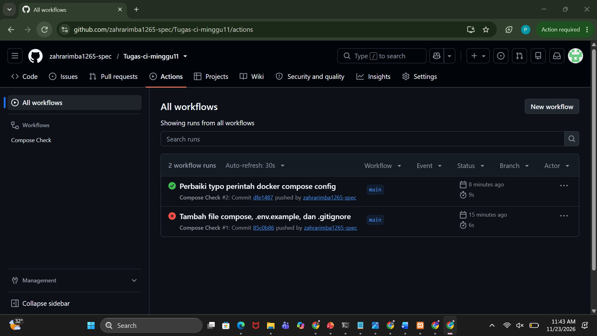
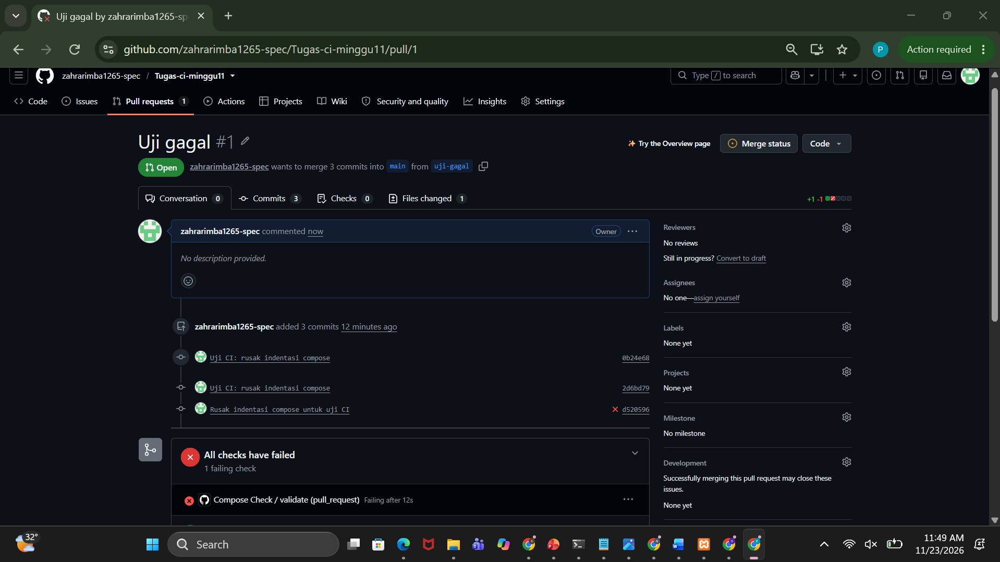
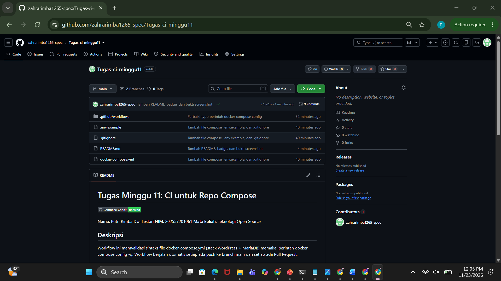

# Tugas Minggu 11: CI untuk Repo Compose

**Nama:** Putri Rimba Dwi Lestari
**NIM:** 202557201061
**Mata kuliah:** Teknologi Open Source

## Deskripsi
Workflow ini memvalidasi sintaks file docker-compose.yml (stack WordPress + MariaDB) memakai perintah docker compose config -q. Workflow berjalan otomatis setiap ada push ke branch main dan setiap ada Pull Request.

## Isi repositori
- .github/workflows/compose-check.yml : workflow CI
- docker-compose.yml : stack WordPress + MariaDB (tugas minggu 10)
- .env.example : contoh variabel lingkungan tanpa rahasia asli
- .gitignore : mengabaikan .env

## Cara kerja workflow
Workflow dipicu oleh dua kejadian: push ke branch main dan pull_request. Di dalamnya ada satu job bernama validate yang berjalan di runner ubuntu-latest. Job ini punya tiga step. Step pertama, actions/checkout@v6, mengambil isi repo ke runner. Step kedua menyalin .env.example menjadi .env, karena file .env asli tidak ada di repo dan variabel di compose butuh nilainya. Step ketiga menjalankan docker compose config -q untuk memeriksa sintaks file compose tanpa menjalankan container. Kalau ada kesalahan, step ini gagal dan check berwarna merah.

## Bukti
1. Run hijau di tab Actions
   
2. Pull Request dengan check gagal (merah)
   
3. Badge status di README
   

Tautan Pull Request (sudah hijau dan di-merge): [TEMPEL TAUTAN PR, contoh https://github.com/zahrarimba1265-spec/Tugas-ci-minggu11/pull/1]

## Kendala dan cara mengatasinya
1. **Run pertama merah karena typo.** Di workflow saya salah mengetik perintah menjadi `docker compose confiq -q`, sehingga step Validasi gagal karena perintah tidak dikenal. Saya memperbaikinya menjadi `docker compose config -q`, lalu commit dan push, dan run berikutnya hijau.
2. **Push ditolak saat login.** Muncul pesan `Password authentication is not supported for Git operations`. Penyebabnya, saya memasukkan password akun, padahal GitHub hanya menerima Personal Access Token untuk git lewat HTTPS. Saya membuat token dengan scope repo dan workflow, lalu memakainya sebagai password.
3. **Error pada PR yang sengaja dirusak.** Setelah satu spasi di depan baris `image:` dihapus, validasi menampilkan `yaml: line 4: did not find expected key`. Saya mengembalikan indentasi sesuai aslinya, push lagi ke branch yang sama, dan check berubah hijau sebelum saya merge.

## Refleksi singkat
CI membuat kesalahan seperti salah indentasi atau typo perintah ketahuan otomatis sebelum file digabung ke main, jadi saya tidak perlu mengecek manual setiap kali. Untuk tugas atau proyek kelompok, ini membantu menjaga branch utama tetap aman dan dapat dijalankan.
